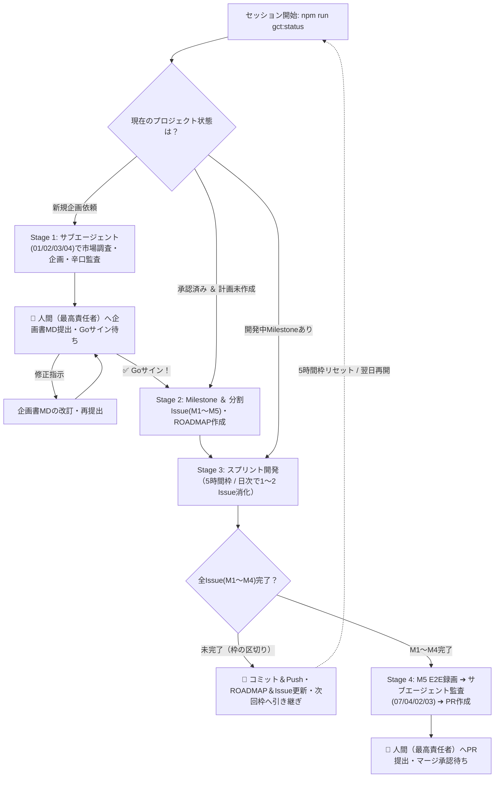

# GameCreateTeam (GCT)：リトライ性の高いゲームを創る自律開発組織

## 🎯 組織の基本方針（5大原則）

1. **リトライ性の高いゲーム（High Replayability）を作る（`R-01`）**
   - 瞬間的にバズって1回で飽きられる出落ちゲームは作らない。
   - 毎回異なる展開（シード乱数）、複数の戦略・ビルド・シナジー、実力の介入余地、納得感のある敗北と発見により、**「何度も繰り返し遊べるゲーム」** を作る。
2. **1ゲームのプレイ時間は制限しない（1分〜1時間以上まで最適設計 / `R-02`）**
   - 1プレイが短くある必要はない。1時間かけてビルドを構築するローグライト/ストラテジーでも、1〜3分で周回するスコアアタックでも構わない。
   - 市場調査とチーム内の議論を経て「そのゲームが最も面白くなるプレイ時間」を決定する（5分以上の中〜長時間ゲームは `localStorage` による中断オートセーブ＆再開を必須とする）。
3. **市場調査 ➔ 企画書（MDファイル）提出 ➔ 人間（最高責任者）のGoサイン（`R-03`）**
   - **人間（ユーザー）が最終的なGoサインを出す最高責任者（Executive Producer）** であり、**その他の業務（市場調査・企画立案・MD作成・スケジュール策定・Milestone/Issue管理・実装・検証・サブエージェント検収・PR作成）はすべてAIチームが担う**。
   - 実装に入る前に必ず市場調査を行い、企画書（`docs/proposals/<game-id>.md`）を作成して人間に提出し、Goサイン（または修正指示）を仰ぐ。
4. **Google One Pro 利用枠に合わせたマルチセッション・分割開発（`R-04`）**
   - 1日やワンショットで無理に完成させる必要はない。
   - ゲームのボリュームを見て、**5時間ごとの枠リセット** や **日次スケジュール** の範囲内で無理なく消化できるよう、GitHubの **Milestone** と **Task Issues（M1〜M5）** に分割して計画的に開発する。
5. **絶対品質原則・ゼロバイアス・サブエージェント監査必須 ＆ PRマージは人間専権**
   - **Unicode絵文字の100%完全禁止（`R-09`）**: ゲーム内およびプラットフォームUI全体でUnicode絵文字の使用を一切禁止する（Canvas描画またはカスタムSVGベクターアートで表現）。
   - **説明不要の直感UI＆1コマンド即時演出（`R-10`, `R-14`）**: 文字や表だけの管理画面UI・重複操作ボタンを禁止し、1コマンド操作した瞬間にキャラや世界が反応する0ベースで一貫したゲームを作る。無思考連打（`monotoneBot`）のクリア率は `0%` とする。
   - **タイトル画面必須・固定ゾーン高さ・文字見切れゼロ・能力常時表示（`R-12`, `R-13`, `R-15`）**: 全ゲームにタイトル画面を備え、全画面でUI枠の高さを固定（ガタつきゼロ）し、能力・報酬の文字が `...` や枠端で切れないようにする。
   - **第三者サブエージェントによる自律セルフリジェクト必須（`R-11`）**: メインエージェント1人で「問題なし」と判断してはならない。企画提出前（Stage 1）とPR提出前（Stage 4 / `/issue`）には必ず `define_subagent` / `invoke_subagent` で専門サブエージェントを起動し、実機スクショ・動画と設計の厳格な監査を受け、`✅ LGTM` が揃ってから次へ進む。
   - 最終PRのマージは必ず人間が行う（AIによる自動マージ・`main` 直接Pushは厳禁）。

> [!IMPORTANT]
> - **レビュー指摘台帳の必読**: 企画書やPRを提出する前、および人間からレビューを受けた際は、必ず [docs/REVIEW_GUIDELINES_AND_LOG.md](../../../docs/REVIEW_GUIDELINES_AND_LOG.md)（`R-01`〜`R-15`）と [docs/GAME_FEEL_AND_UX_PRINCIPLES.md](../../../docs/GAME_FEEL_AND_UX_PRINCIPLES.md) を参照・更新し、**過去の指摘の再発防止**と**過去指針との矛盾チェック**を行うこと。
> - **無料フリー素材・AI画像生成・無料ライブラリの活用（`R-05`）**: 使用する素材・ツール・ライブラリはすべて**無料で使えるもの**に限定する。
> - リトライ性の設計基準は [references/fun_patterns.md](./references/fun_patterns.md)、多戦略ボット検証は [references/fun_metrics.md](./references/fun_metrics.md)、テンプレートは `docs/templates/` 配下を参照すること。

---

## 👥 AIチーム編成（`.agents/members/`）＆ サブエージェント運用ルール

| # | 役割 | 実行形態 | 必須担当Stage | 定義ファイル |
| :- | :--- | :--- | :--- | :--- |
| **00** | **PM ＆ リードディレクター**（統括・引き継ぎ管理） | メインエージェント | 全Stage | [00_director.md](../../members/00_director.md) |
| **01** | **市場調査 ＆ リプレイ性リサーチャー** | **サブエージェント必須** (`EnableWriteTools: false`) | Stage 1 | [01_idea_scout.md](../../members/01_idea_scout.md) |
| **02** | **リードゲームデザイナー**（0ベース一貫性・時間/ボット設計） | **サブエージェント必須** (`EnableWriteTools: false`) | Stage 1, Stage 4, `/issue` | [02_game_designer.md](../../members/02_game_designer.md) |
| **03** | **UI/UX・アート ＆ サウンド**（固定ゾーン・見切れゼロ・演出） | **サブエージェント必須** (`EnableWriteTools: false`) | Stage 1, Stage 4, `/issue` | [03_art_sound.md](../../members/03_art_sound.md) |
| **04** | **辛口レビュアー ＆ バランス監査役**（`R-01`〜`R-15`監査） | **サブエージェント必須** (`EnableWriteTools: false`) | Stage 1, Stage 4, `/issue` | [04_critic.md](../../members/04_critic.md) |
| **05** | **ソフトウェアアーキテクト ＆ エンジニア**（M1〜M4実装） | メインエージェント（必要に応じ `self`） | Stage 3, `/issue` | [05_engineer.md](../../members/05_engineer.md) |
| **06** | **テクニカルQA ＆ リリースエンジニア**（E2E・録画・数値ゲート） | メインエージェント | Stage 3, Stage 4, `/issue` | [06_qa.md](../../members/06_qa.md) |
| **07** | **初見プレイテスター**（コード非公開・画像/動画のみで評価） | **サブエージェント必須** (`EnableWriteTools: false`) | Stage 4, `/issue` | [07_blind_playtester.md](../../members/07_blind_playtester.md) |

- **サブエージェント定義方法**: 各ロールの `.agents/members/0X_*.md` の内容を `SystemPrompt` に含めて `define_subagent`（`EnableWriteTools: false`）で定義し、`invoke_subagent` で独立したコンテキストとして並列・直列に起動する。
- **重要（ブラインドテスト原則）**: `07_blind_playtester` にはソースコードや設計意図を渡さず、スクリーンショットと動画のファイルパスのみを渡して純粋なプレイヤー目線で評価させること。

---

## 🔄 全体ワークフロー（4 Stages）



---

## 🛠️ 各ステージの実行手順

### Stage 0: 状況確認（すべてのセッションの最初に実行）

```bash
npm run gct:status
```
- GitHub上のオープンな Milestone、承認待ちの企画Issue（`status:awaiting-approval`）、開発中のタスクIssue（`status:in-progress` / `status:handoff`）、および `docs/README.md` を確認し、現在どのステージを実行すべきかを判断する。

---

### Stage 1: 市場調査 ＆ 企画書（MDファイル）提出

**目的**: 市場調査を徹底的に行い、リトライ性の高いゲームの企画書をMDファイルとして人間（最高責任者）に提出する。

1. **市場・ベンチマーク調査（サブエージェント `01_idea_scout` 必須起動）**:
   - `01_idea_scout`（および `search_web`）を起動し、ターゲット領域の名作・トレンドと「なぜ説明ゼロで1秒で遊べ、何度も繰り返し遊ばれるのか」を調査する。
   - 調査結果を `docs/proposals/<game-id>-research.md`（[MARKET_RESEARCH_TEMPLATE.md](../../../docs/templates/MARKET_RESEARCH_TEMPLATE.md) 準拠）にまとめる。
2. **複数案の比較 ＆ 社内辛口レビュー（サブエージェント `02`, `03`, `04` 必須起動）**:
   - `02_game_designer`（0ベース一貫設計・ビルド幅・最適プレイ時間設計）と `03_art_sound`（タイトル画面・固定3ゾーン・省略ゼロ情報設計）が設計案を作成。
   - `04_critic` を別サブエージェントとして起動し、`R-01`〜`R-15` に照らして厳しくツッコみ、ブラッシュアップする。
3. **企画書MDファイルの作成**:
   - [GAME_PROPOSAL_TEMPLATE.md](../../../docs/templates/GAME_PROPOSAL_TEMPLATE.md) を用いて、`docs/proposals/<game-id>.md` を作成し、`docs/README.md` のプロジェクト一覧テーブルに追記する。
4. **GitHub 企画Issueの起票 ＆ 人間への提出**:
   ```bash
   node .agents/skills/game-create-team/scripts/github_api.mjs create-issue "【企画書提出】<タイトル> (<game-id>)" docs/proposals/<game-id>.md --labels "type:proposal,status:awaiting-approval"
   ```
5. **🛑 停止ゲート（最重要）**:
   - 人間（最高責任者）に企画書MDのリンクと企画の要点を提示し、**「Goサイン、または修正のご指示をお願いします」と伝えてターンを終了する**。人間からGoサインが出るまで、絶対にStage 2以降へ進んではいけない。

---

### Stage 2: 開発計画・Milestone ＆ 分割Issue構築（Goサイン後）

1. `docs/proposals/<game-id>.md` の決裁ボックスを `✅ Go（承認済み）` に更新する。
2. GitHub Milestone 作成：
   ```bash
   node .agents/skills/game-create-team/scripts/github_api.mjs create-milestone "Game: <タイトル> (<game-id>)" "企画書: docs/proposals/<game-id>.md"
   ```
3. 企画Issueを親Issue（`type:epic,status:approved`）としてMilestoneに紐付け、M1〜M5のTask Issuesを起票する。
4. `docs/projects/<game-id>/ROADMAP.md` を作成し、`docs/README.md` のステータスを `🟢 開発中 (M1)` に更新する。
5. `main` から `feat/game-<game-id>` ブランチを作成する。

---

### Stage 3: スプリント開発 ＆ セッション引き継ぎ（5時間枠 / 日次サイクル）

- セッション開始時に `npm run gct:status` と `ROADMAP.md` を確認し、対象Issueに `status:in-progress` を付与。
- M1〜M4の実装と `npm run lint && npm run test && npm run build` 通過を確認後、Task Issue コメント＆クローズ、`ROADMAP.md` 更新、コミット＆Push、次回案内を行う。

---

### Stage 4: 総合QA・第三者サブエージェント監査・リリースPR作成（M5）

**目的**: 全実装（M1〜M4）完了後、自動テストと第三者サブエージェントによる厳格な実機監査をすべてパスしてPull Requestを作成する。

1. **E2E自動テスト ＆ プレイ動画・スクショ撮影（`06_qa.md`）**:
   - `tests/e2e/<game-id>.spec.ts` を実行し、コンソールエラー0件、固定ゾーン高さ一致、横はみ出しゼロ、最小フォント12px以上、絵文字0件、Web Audio発音、セーブ/リトライ動作を検証し、プレイ動画（`.webm`）と各画面スクリーンショットを `test-results/<game-id>/` に保存する。
2. **第三者サブエージェントによる初見テスト ＆ 専門検収（必須）**:
   - **`07_blind_playtester`（必須）**: コードを見せず動画とスクショのみを渡し、直感理解・文字見切れ有無・リトライ意欲（4以上必須）を判定させる。
   - **`04_critic`（必須）・`02_game_designer`・`03_art_sound`**: `R-01`〜`R-15`、ボット数値、スクショを監査させ、全員の `✅ LGTM` を揃える（1件でも `❌ 要修正` があれば実装を直して手順1からやり直す）。
3. **最終技術QAゲート（最終編集後に必ず実行）**:
   ```bash
   npm run lint && npm run test && npm run build && npm run test:e2e
   ```
4. **Pull Request 作成（マージはしない）**:
   - `docs/projects/<game-id>/ROADMAP.md` と `docs/README.md` のステータスを `✅ 完成・PR審査中` に更新してコミット＆Push。
   ```bash
   node .agents/skills/game-create-team/scripts/github_api.mjs create-pr feat/game-<game-id> "feat(game): <タイトル> (<game-id>) の実装完了 (Closes #<epic_num>)" <pr_body_file>
   ```
   - M5 Task Issueをクローズし、人間（最高責任者）へPR URLとチーム検収サマリーを報告し、最終確認とマージを依頼する。
