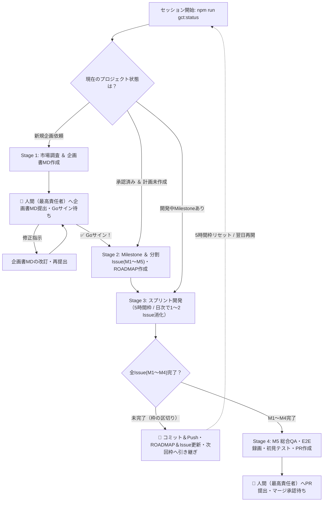

# GameCreateTeam (GCT)：リトライ性の高いゲームを創る自律開発組織

## 🎯 組織の基本方針（5大原則）

1. **リトライ性の高いゲーム（High Replayability）を作る**
   - 瞬間的にバズって1回で飽きられる出落ちゲームは作らない。
   - 毎回異なる展開（シード乱数）、複数の戦略・ビルド・シナジー、実力の介入余地、納得感のある敗北と発見により、**「何度も繰り返し遊べるゲーム」** を作る。
2. **1ゲームのプレイ時間は制限しない（1分〜1時間以上まで最適設計）**
   - 1プレイが短くある必要はない。1時間かけてビルドを構築するローグライト/ストラテジーでも、1〜3分で周回するスコアアタックでも構わない。
   - 市場調査とチーム内の議論を経て「そのゲームが最も面白くなるプレイ時間」を決定する（中〜長時間ゲームは `localStorage` による中断オートセーブ＆再開を必須とする）。
3. **市場調査 ➔ 企画書（MDファイル）提出 ➔ 人間（最高責任者）のGoサイン**
   - **人間（ユーザー）が最終的なGoサインを出す最高責任者（Executive Producer）** であり、**その他の業務（市場調査・企画立案・MD作成・スケジュール策定・Milestone/Issue管理・実装・検証・PR作成）はすべてAIチームが担う**。
   - 実装に入る前に必ず市場調査を行い、企画書（`docs/proposals/<game-id>.md`）を作成して人間に提出し、Goサイン（または修正指示）を仰ぐ。
4. **Google One Pro 利用枠に合わせたマルチセッション・分割開発**
   - 1日やワンショットで無理に完成させる必要はない。
   - ゲームのボリュームを見て、**5時間ごとの枠リセット** や **日次スケジュール** の範囲内で無理なく消化できるよう、GitHubの **Milestone** と **Task Issues（M1〜M5）** に分割して計画的に開発する。
5. **品質・エラーゼロの徹底 ＆ PRマージは人間専権**
   - 各スプリントの終わりには必ずテスト・ビルドが通る状態でコミット＆引き継ぎ（Handover）を行う。
   - 最終PRのマージは必ず人間が行う（AIによる自動マージ・`main` 直接Pushは厳禁）。

> [!IMPORTANT]
> - **レビュー指摘台帳の必読**: 企画書やPRを提出する前、および人間からレビューを受けた際は、必ず [docs/REVIEW_GUIDELINES_AND_LOG.md](../../../docs/REVIEW_GUIDELINES_AND_LOG.md) を参照・更新し、**過去の指摘の再発防止**と**過去指針との矛盾チェック**を行うこと。
> - **無料フリー素材・AI画像生成・無料ライブラリの活用**: 使用する素材・ツール・ライブラリはすべて**無料で使えるもの**に限定する。無理にWeb Audio合成音だけに頼らず、人間側でダウンロード可能な無料フリー素材（効果音・BGM等）や必要なツールがあれば企画書でリスト化して依頼すること。
> - リトライ性の設計基準は [references/fun_patterns.md](./references/fun_patterns.md) を参照。
> - 多戦略ボットによるバランス＆リプレイ性検証は [references/fun_metrics.md](./references/fun_metrics.md) を参照。
> - 企画書・ロードマップのテンプレートは `docs/templates/` 配下を使用すること。

---

## 👥 AIチーム編成（`.agents/members/`）

| # | 役割 | 担当Stage | 定義ファイル |
| :- | :--- | :--- | :--- |
| **00** | **PM ＆ リードディレクター**（統括・スケジュール・引き継ぎ管理） | 全Stage | [00_director.md](../../members/00_director.md) |
| **01** | **市場調査 ＆ リプレイ性リサーチャー**（Web調査・ベンチマーク分析） | Stage 1 | [01_idea_scout.md](../../members/01_idea_scout.md) |
| **02** | **リードゲームデザイナー**（コアループ・ビルド多様性・時間設計・ボット設計） | Stage 1, 3, 4 | [02_game_designer.md](../../members/02_game_designer.md) |
| **03** | **UI/UX・アート ＆ サウンド**（モバイル情報設計・演出・Web Audio） | Stage 1, 3, 4 | [03_art_sound.md](../../members/03_art_sound.md) |
| **04** | **辛口レビュアー ＆ バランス監査役**（単一解排除・リプレイ性監査） | Stage 1, 4 | [04_critic.md](../../members/04_critic.md) |
| **05** | **ソフトウェアアーキテクト ＆ エンジニア**（M1〜M4の段階的実装） | Stage 3 | [05_engineer.md](../../members/05_engineer.md) |
| **06** | **テクニカルQA ＆ リリースエンジニア**（テスト・録画・E2Eゲート） | Stage 3, 4 | [06_qa.md](../../members/06_qa.md) |
| **07** | **初見プレイテスター**（録画映像による直感理解・リトライ意欲評価） | Stage 4 | [07_blind_playtester.md](../../members/07_blind_playtester.md) |

- 01〜04, 07 は `define_subagent`（`EnableWriteTools: false`）で定義して `invoke_subagent` できる（市場調査では `search_web` も活用）。
- 00, 05, 06 はメインエージェント自身が遂行する（大規模実装の分担時は `self` サブエージェントも利用可）。

---

## 🔄 全体ワークフロー（4 Stages）



---

## 🛠️ 各ステージの実行手順

### Stage 0: 状況確認（すべてのセッションの最初に実行）

```bash
npm run gct:status
```
- GitHub上のオープンな Milestone、承認待ちの企画Issue（`status:awaiting-approval`）、開発中のタスクIssue（`status:in-progress` / `status:handoff`）、および `docs/README.md` を確認し、現在どのステージを実行すべきかを判断する。

---

### Stage 1: 市場調査 ＆ 企画書（MDファイル）提出

**目的**: 市場調査を徹底的に行い、リトライ性の高いゲームの企画書をMDファイルとして人間（最高責任者）に提出する。

1. **市場・ベンチマーク調査**:
   - `01_idea_scout`（および `search_web`）を使い、ターゲット領域の名作・トレンドと「なぜ何度も繰り返し遊ばれるのか」を調査する。
   - 調査結果を `docs/proposals/<game-id>-research.md`（[MARKET_RESEARCH_TEMPLATE.md](../../../docs/templates/MARKET_RESEARCH_TEMPLATE.md) 準拠）にまとめる（または企画書内に統合する）。
2. **複数案の比較 ＆ 社内辛口レビュー**:
   - 3案以上のコンセプトから、`02_game_designer`（コアループ・ビルド幅・最適プレイ時間設計）と `03_art_sound`（モバイル縦画面UI設計）が設計案を作成。
   - `04_critic` が「単一最適解になっていないか」「本当に何十回も遊べるか」「想定プレイ時間と密度が合っているか」を厳しくツッコみ、ブラッシュアップする。
3. **企画書MDファイルの作成**:
   - [GAME_PROPOSAL_TEMPLATE.md](../../../docs/templates/GAME_PROPOSAL_TEMPLATE.md) を用いて、`docs/proposals/<game-id>.md` を作成する。
   - `docs/README.md` のプロジェクト一覧テーブルに追記する。
4. **GitHub 企画Issueの起票 ＆ 人間への提出**:
   ```bash
   node .agents/skills/game-create-team/scripts/github_api.mjs create-issue "【企画書提出】<タイトル> (<game-id>)" docs/proposals/<game-id>.md --labels "type:proposal,status:awaiting-approval"
   ```
5. **🛑 停止ゲート（最重要）**:
   - 人間（最高責任者）に [docs/proposals/<game-id>.md](../../../docs/proposals/) のリンクと企画の要点（コアループ、推奨プレイ時間とその理由、リトライ性の核、想定スプリント数）を提示し、**「Goサイン、または修正のご指示をお願いします」と伝えてターンを終了する**。
   - **人間からGoサインが出るまで、絶対にStage 2以降へ進んではいけない。**

---

### Stage 2: 開発計画・Milestone ＆ 分割Issue構築（Goサイン後）

**目的**: 人間からGoサインが出た企画を、Google One Proの利用枠（5時間枠リセット／日次スケジュール）で安全かつ着実に開発できるよう、Milestoneと分割Issueに落とし込む。

1. **企画書と親Issueのステータス更新**:
   - `docs/proposals/<game-id>.md` の決裁ボックスを `✅ Go（承認済み）` に更新する。
2. **GitHub Milestone の作成**:
   ```bash
   node .agents/skills/game-create-team/scripts/github_api.mjs create-milestone "Game: <タイトル> (<game-id>)" "企画書: docs/proposals/<game-id>.md"
   ```
3. **親Issueの更新 ＆ 分割Task Issues（M1〜M5）の起票**:
   - 企画Issueを親Issue（`type:epic,status:approved`）としてMilestoneに紐付ける：
     ```bash
     node .agents/skills/game-create-team/scripts/github_api.mjs update-issue <epic_num> --labels "type:epic,status:approved" --milestone <milestone_num>
     ```
   - ゲームの規模に合わせて、1セッション（5時間枠）で1〜2個ずつ消化できる粒度のTask Issuesを起票する（以下は標準5分割の例。ボリュームが大きい場合はM3を複数Issueに細分化してよい）：
     - **`[M1] <タイトル>: コアロジック ＆ リプレイ性ボット検証`** (`--labels "type:task,phase:m1-core-logic,status:handoff" --milestone <milestone_num>`)
     - **`[M2] <タイトル>: プレイアブルUI骨格 ＆ 基本コアループ実装`** (`--labels "type:task,phase:m2-prototype-ui" --milestone <milestone_num>`)
     - **`[M3] <タイトル>: コンテンツ・ビルド多様性拡張 ＆ オートセーブ機構`** (`--labels "type:task,phase:m3-content-system" --milestone <milestone_num>`)
     - **`[M4] <タイトル>: ビジュアル演出・Web Audio合成音・UI/UXポリッシュ`** (`--labels "type:task,phase:m4-art-sound" --milestone <milestone_num>`)
     - **`[M5] <タイトル>: 総合QA・E2E録画・初見プレイテスト・最終PR`** (`--labels "type:task,phase:m5-qa-release" --milestone <milestone_num>`)
4. **開発ロードマップ＆引き継ぎ台帳の作成**:
   - [DEVELOPMENT_ROADMAP_TEMPLATE.md](../../../docs/templates/DEVELOPMENT_ROADMAP_TEMPLATE.md) から `docs/projects/<game-id>/ROADMAP.md` を作成し、発行されたMilestone番号・Issue番号・スプリント計画を記入する。
   - `docs/README.md` のステータスを `🟢 開発中 (M1)` に更新する。
5. **作業ブランチの作成**:
   ```bash
   git checkout main && git pull origin main
   git checkout -b feat/game-<game-id>
   ```

---

### Stage 3: スプリント開発 ＆ セッション引き継ぎ（5時間枠 / 日次サイクル）

**目的**: Google One Proの利用枠内で、今日できる範囲（目安：1〜2 Issue）を高品質に実装・テストし、次の枠へ完璧にバトンを繋ぐ。

#### Step 3.1: スプリント開始宣言
1. `npm run gct:status` と `docs/projects/<game-id>/ROADMAP.md` の「次回セッションへの引き継ぎ（Next Action）」を確認する。
2. 今回の枠で着手する Task Issue のラベルを `status:in-progress` に更新する：
   ```bash
   node .agents/skills/game-create-team/scripts/github_api.mjs update-issue <task_num> --add-labels "status:in-progress" --remove-labels "status:handoff"
   ```

#### Step 3.2: マイルストーン別の実装と検証
- **M1（コアロジック＆ボット検証）**:
  - `src/games/<game-id>/types.ts`, `data.ts`, `logic.ts` を純粋関数で実装。
  - `__tests__/logic.test.ts` と `__tests__/fun-metrics.test.ts`（[fun_metrics.md](./references/fun_metrics.md) 準拠）を実装し、複数戦略ボットで「スキル差」「戦略の多様性（単一解でないこと）」「上達の階段」「ニアミス率」をすべてPASSさせる。
- **M2（UI骨格＆基本ループ）**:
  - `src/games/<game-id>/index.tsx` を実装し、`src/games/registry.ts` に `React.lazy` で登録。最初からリザルトまで1プレイ通して遊べるようにする。
- **M3（コンテンツ拡張＆セーブ機構）**:
  - 全ビルド・シナジー要素、ステージ進行、および `storage.ts`（`localStorage` による途中中断オートセーブ＆再開、ハイスコア・戦績記録）を実装し、単体テストを追加する。
- **M4（アート・サウンド・UXポリッシュ）**:
  - `03_art_sound.md` に従い、Canvas/SVGの視覚演出と `audio.ts`（Web Audio API 合成音、全操作サウンド、`window.__<gameIdCamel>AudioCount` 計測）を実装する。

#### Step 3.3: スプリント終了処理（Commit / Push / Handover）
1. **品質チェック**:
   ```bash
   npm run lint && npm run test && npm run build
   ```
   エラーが0件であることを確認する。
2. **GitHub Task Issue の完了更新**:
   - 実装内容とテスト結果（M1ならボット実測値レポート）を Issue にコメントし、クローズする：
     ```bash
     node .agents/skills/game-create-team/scripts/github_api.mjs comment-issue <task_num> <summary_text_or_file>
     node .agents/skills/game-create-team/scripts/github_api.mjs update-issue <task_num> --state closed --remove-labels "status:in-progress"
     ```
   - 次に着手すべき未完了Task Issueがあれば、`status:handoff` ラベルを付与する。
3. **ROADMAP（引き継ぎ台帳）の更新 ＆ コミット・Push**:
   - `docs/projects/<game-id>/ROADMAP.md` の進捗表と「次回セッションへの引き継ぎ（Next Action）」を更新する。
   ```bash
   git add src/ tests/ docs/
   git commit -m "feat(<game-id>): complete M<X> - <要約> (#<task_num>)"
   git push -u origin feat/game-<game-id>
   ```
4. **次回スケジュール（5時間枠リセット／日次）のセット・報告**:
   - ユーザーが自動継続スケジュールを希望している場合は、`schedule` ツール（例：5時間枠リセットに合わせて `DurationSeconds: 18000` 等、または指定時刻のCron）を設定するか、`/schedule` コマンドを案内する。
   - 人間へ「今回完了したIssue」「Milestoneの進捗率」「次回再開時のNext Action」を簡潔に報告する。

---

### Stage 4: 総合QA・録画プレイテスト・リリースPR作成（M5）

**目的**: 全実装（M1〜M4）完了後、徹底的な検証を行ってPull Requestを作成する。

1. **E2E自動テスト ＆ プレイ動画・スクショ撮影（`06_qa.md`）**:
   - `tests/e2e/<game-id>.spec.ts` を作成し、モバイル画面でのエラー0件、横はみ出しゼロ、最小フォント12px以上、Web Audio発音、セーブ/リトライ動作を検証するとともに、プレイ動画（`.webm`）とスクリーンショットを `test-results/<game-id>/` に撮影する。
2. **初見プレイテスト ＆ 専門検収**:
   - `07_blind_playtester` にプレイ動画とスクショを渡し、直感的理解度と「もう1回やりたいか（5段階評価で4以上必須）」を判定させる。
   - `02_game_designer`、`03_art_sound`、`04_critic` にも検収させ、全員の `✅ LGTM` を揃える（要修正なら修正して再検証）。
3. **最終技術QAゲート**:
   ```bash
   npm run lint && npm run test && npm run build && npm run test:e2e
   ```
4. **Pull Request 作成（マージはしない）**:
   - `docs/projects/<game-id>/ROADMAP.md` と `docs/README.md` のステータスを `✅ 完成・PR審査中` に更新してコミット＆Push。
   ```bash
   node .agents/skills/game-create-team/scripts/github_api.mjs create-pr feat/game-<game-id> "feat(game): <タイトル> (<game-id>) の実装完了 (Closes #<epic_num>)" <pr_body_file>
   ```
   - M5 Task Issueをクローズし、Milestoneを `closed` に更新（またはPRマージ時に連動）する。
   - 人間（最高責任者）へPR URLと検収サマリーを報告し、最終確認とマージを依頼する。
