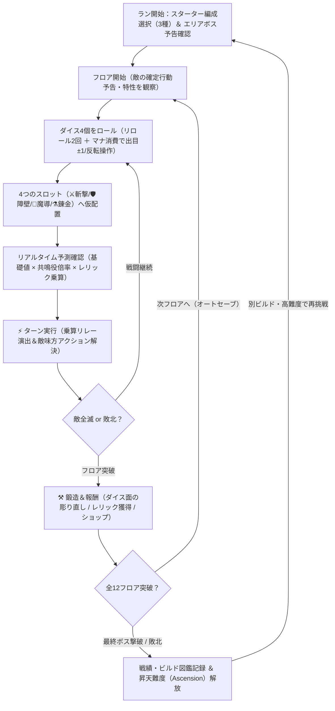

# 📋 ゲーム企画書：『ダイス・フォージ・ダンジョン：魔導刻印と運命の塔』 (`dice-forge-dungeon`)

> [!IMPORTANT]
> **【最高責任者（人間）決裁ボックス】**
> - **現在のステータス**: `🟡 レビュー・Goサイン待ち (status:awaiting-approval)`
> - **企画提出日**: 2026-11-15
> - **GitHub 企画Issue**: `#12` (https://github.com/Nakako0281/GameCreateTeam/issues/12)
> - **関連市場調査レポート**: [docs/proposals/dice-forge-dungeon-research.md](./dice-forge-dungeon-research.md)
> - **決裁アクション**:
>   - [ ] **✅ Go（承認）** ── この企画で開発計画（GitHub Milestone / 分割Issue作成）および段階的実装へ進む
>   - [ ] **🔄 条件付きGo / 修正指示** ── 下記フィードバックを反映して企画調整後に進行（または再提出）
>   - [ ] **❌ 却下** ── 別企画（次点候補の『グリッド・シタデル』等）へ切り替え
> - **最高責任者からのフィードバック・指示メモ**:
>   - *(チャット、または本ファイル／GitHub IssueにてGoサインや修正点をご指示ください)*

---

## 1. エグゼクティブサマリー（概要）

| 項目 | 内容 |
| :--- | :--- |
| **ゲームID** | `dice-forge-dungeon` |
| **タイトル** | **ダイス・フォージ・ダンジョン：魔導刻印と運命の塔** |
| **コンセプト（一言）** | 4個のダイスの「6面そのもの」を毎フロア彫り直し、スロット配置とレリックの乗算連鎖で強敵を粉砕する、本格タクティカル・ダイス構築ローグライト。 |
| **ジャンル / タグ** | `シミュレーション` / `パズル`（ローグライト・デッキ/ダイス構築・ターン制戦術） |
| **想定1プレイ時間** | **1プレイ 15〜25分（全3エリア・12フロア構成 ／ `localStorage` ターン＆フロア自動中断セーブ対応）** |
| **プレイ時間の設定理由** | 初期ダイス4個（計24面）を1フロアごとに1〜2面ずつ特殊刻印へ彫り直していく際、**序盤（1〜4F）で軸を決め、中盤（5〜8F）でシナジーを形成し、終盤（9〜12F）で完成したカスタムダイスをぶん回して大ボスを突破する**のに12フロア（15〜25分）が最も濃密で満足度が高いため。 |
| **ターゲット体験** | 「自分で確率（ダイスの面）をデザインしたイカサマダイス」と「レリック×共鳴役」が噛み合い、`基礎値 × 役倍率 × レリック倍率` で100〜300超えのダメージや鉄壁シールドが炸裂する脳汁体験。敗北しても「次は偶数シールド反撃軸で組もう」「次は小目1・2連撃毒ビルドを試そう」と即座に再挑戦したくなる中毒性。 |

---

## 2. 市場調査サマリー ＆ 差別化ポイント

*(詳細は [dice-forge-dungeon-research.md](./dice-forge-dungeon-research.md) を参照)*

### 2.1 ベンチマークと市場背景
- **参考ベンチマーク作品**: ***Slice & Dice***（ダイス面カスタム×完全情報戦術）、***Balatro***（役ボーナス×ジョーカー乗算リレー演出）、***Slay the Spire***（ルート選択・レリックシナジー）、***Into the Breach***（敵行動100%予告による納得感）。
- **市場で支持されている理由**: 「ランダムな出目」をそのまま運任せにするのではなく、**「リロール・マナ操作による確定介入」** と **「ダイスの面自体の書き換え（エンジン構築）」** によってプレイヤーの知略で制御できる点が、何十時間も遊ばれる最大の要因となっています。

### 2.2 本作独自のフック（差別化）
1. **「4スロット個別適性」×「全体共鳴役（ポーカー風コンボ）」の2軸パズル**:
   - ダイスを4つの戦術スロット（⚔️斬撃 / 🛡️障壁 / 🔮魔導 / ⚗️錬金）のどこに置くかという「個別判断」と、配置した4個の出目全体で成立する「共鳴役（ペア・ツーペア・ストレート・オール偶数/奇数・オーバーロード20+）」の「全体倍率」が1画面で融合。
2. **モバイル縦画面（`375〜430px`）に特化した「2タップ快適配置＆リアルタイム結果プレビュー」**:
   - 小さな画面でのドラッグ誤操作や暗算ストレスをゼロにするため、ダイスをスロットに仮置きした瞬間に「与ダメージ・獲得シールド・敵攻撃後の残HP予測」が即座にプレビュー計算されます。

---

## 3. リトライ性（Replayability）のコア設計

### 3.1 コアループ図（1ターン戦術 × 1ラン戦略の二重ループ）

### 3.2 リトライ性を生む4大要素と「単一最適解」の排除

1. **毎プレイの変化（Procedural Variety）**:
   - シード乱数により、各フロアの敵編成、エリアボス（各エリア複数候補から抽選＆エリア開始時に事前予告）、ドロップする「魔導刻印（全30種以上）」と「レリック（全24種以上）」、イベント祭壇が毎回変化します。
2. **3種のスターター編成 × 3系統以上のビルド・シナジー**:
   - 初期ダイス構成が異なる3つのクラス編成（①見習い魔導師［バランス］、②影の暗殺者［小目・毒寄り］、③重装鍛冶師［偶数・装甲寄り］）と、クリアごとに解放される高難度モード（Ascension Lv1〜Lv3）を搭載。
   - **系統A【迅雷・猛毒アサシン（出目1・2連撃 × 毒増殖 × 再配置Cantrip）】**
   - **系統B【鉄壁・反撃フォートレス（偶数出目 × シールド半永続持ち越し × 盾撃ボディスラム）】**
   - **系統C【星辰・魔導アルカナ（高出目5・6+ × マナ限界突破 × 全体貫通魔導バースト）】**
3. **単一最適解・ハメ技を防ぐ3つの安全装置（`04_critic` 監査反映）**:
   - **① 同名刻印の上限とコスト漸増**: 「最強の面1種類だけで全24面を埋め尽くす」思考停止を防ぐため、**同一の特殊刻印は1つのダイスにつき最大2面まで**とし、同じ出目への彫り直しコストが段階的に上昇するルールとします。
   - **② 遅延ハメ（Stalling）防止キャップ**: 弱い敵を残して無限にゴールドやマナを稼ぐハメ技を防ぐため、**「⚗️錬金スロットの資源生成は1戦闘につき最大2回まで」** かつ **「各戦闘の6ターン目以降、敵は『狂暴化（毎ターン攻撃力+50%）』する」** 仕様とします。
   - **③ エリアボス事前予告とアンチ特性**: 各エリア開始時（Floor 1 / 5 / 9）にボス特性（例：連撃に対する『棘の甲殻』、高単発に対する『ダメージ上限障壁』、防御固めに対する『破甲攻撃』）を予告表示し、プレイヤーが4フロアかけて弱点を補うサブプランを織り交ぜる戦略性を生み出します。

---

## 4. ゲームシステム・数値・画面仕様詳細

### 4.1 モバイル縦画面レイアウト（`375px〜430px` × `100dvh` / スクロールなし）

最小フォントサイズ `12px` 以上を厳守し、親指のタップ操作だけで完結する5段固定レイアウトとします。

1. **トップバー（`48px`）**: フロア進行度（`F2-3`）、現在HP/最大HP＋現在シールド、所持ゴールド（💰）、所持マナ（🔮 `MP 4/10`）、オートセーブインジケーター（💾）。
2. **レリックバー（`44px`）**: 最大5枠の所持レリックアイコン。タップすると固定インフォバーに `12px` で効果詳細を表示。
3. **バトル＆シナジーアリーナ（`flex-1` / Canvas + SVG）**:
   - 敵グラフィック、HP/シールドバー、状態異常（毒・弱体・棘）、および **「⚠️ 次ターン確定行動予告（例：強襲 16 DMG）」** を明快に表示。
   - ターン実行時には中央で `[基礎 12] × [共鳴役 1.50] × [遺物 1.40] ➔ 💥 25 DMG!` の乗算リレー演出が展開。
4. **タクティカル・スロットエリア（`108px`）**:
   - **⚔️斬撃（2枠）** / **🛡️障壁（1枠）** / **🔮魔導（1枠）** / **⚗️錬金（1枠）**。
   - ダイスを仮置きした時点で、成立している「共鳴役バッジ（例：`✨ツーペア ×1.50`）」と、各スロットの最終予測値および被弾後の残HP予測をリアルタイム表示。
5. **ダイストレイ＆親指コントロール（`120px`）**:
   - 4個のダイス（各 `54px×54px`、出目数字 `16px bold` ＋ 刻印アイコン）。タップで選択し、スロットをタップして配置（再タップでトレイへ返却）。
   - 下部ボタン：`[🔄 リロール(残2)]`、`[🔮 マナ介入(出目±1 / 反転)]`、`[⚒️ 6面確認]`、`[⚡ ターン実行]`。

### 4.2 計算式と共鳴役（Formation Combo）

$$\text{最終効果量} = \lfloor (\text{ダイス出目} + \text{刻印基礎ボーナス} + \text{バフ加算}) \times \text{共鳴役倍率} \times \text{レリック乗算倍率} \rfloor$$

- **共鳴役（4個の配置ダイスの出目組み合わせ）**:
  - **ワンペア**: `×1.25` ／ **ツーペア**: `×1.50` ／ **ストレート（4連番）**: `×1.75` ／ **スリーカード**: `×1.80` ／ **フォーカード**: `×2.50`
  - **複合ボーナス**: **オール偶数 / オール奇数**（`+0.35x` 加算）、**オーバーロード（出目合計20以上）**（さらに `×1.30` 乗算）

### 4.3 全12フロア（3エリア×4フロア）の黄金ペーシング
各エリア（4フロア単位）を以下のリズムで構成し、中だるみを防ぎます：
- **F1 / F5 / F9（前哨戦＋ボス予告）**: 基本戦闘 ＋ 終了時に「ダイス面刻印（3択）」
- **F2 / F6 / F10（精鋭エリート戦 or 秘境の祭壇選択）**: リスクを取ってエリートを倒し「レアレリック＋刻印」を得るか、祭壇イベントで特殊改造を行うかを選択
- **F3 / F7 / F11（中堅戦＋鍛冶屋＆魔導ショップ）**: 稼いだゴールドで「ダイス面の彫り直し」「レリック購入/売却」「HP回復」を行いボス戦に備える
- **F4 / F8 / F12（エリアボス決戦）**: 予告されていた固有ギミックを持つボスとの総力戦

### 4.4 セーブ・永続化仕様（`localStorage`）
- **オートセーブ＆途中再開（Continue）**: 毎ターン開始時およびフロア移動時に現在のラン状態（シード、ダイス24面の構成、所持レリック、HP、フロア進行）を `localStorage` に自動保存。いつでも中断・再開可能。
- **永続戦績＆図鑑**: 最高スコア、クリア回数、解放済みAscensionレベル、発見した刻印・レリック図鑑を永続記録。

### 4.5 ビジュアル・サウンド ＆ 無料フリー素材・ライブラリ調達計画（Issue #12 レビュー反映）

開発に使用する素材・ツール・ライブラリはすべて**無料で利用できるもの**に統一します。また、無理にプログラム合成音（Web Audio合成のみ）で済ませず、実録音のフリー効果音素材・BGM・AI生成画像を組み合わせてリッチな手触りを実現します。

#### ① 人間（最高責任者）へ調達をお願いしたい無料フリー音声素材リスト
`public/assets/games/dice-forge-dungeon/audio/` 配下に配置する想定です（効果音ラボ、魔王魂、DOVA-SYNDROME、Kenney等の無料素材で構いません。なお、**M1〜M3の開発中は素材が未配置でもエラーにならず仮音で動作するフォールバック機構**を入れておくため、M4フェーズまでに順次ご用意いただければ問題ありません）：

| ファイル名（予定） | 用途・タイミング | 音のニュアンス・イメージ |
| :--- | :--- | :--- |
| `se_dice_roll.mp3` | ダイスを振る時 | サイコロが複数個コロコロッと転がる軽快な音（0.4〜0.8秒程度） |
| `se_dice_place.mp3` | ダイスをスロットに配置した時 | 木の駒や石を「カチッ / コトン」と盤面に置く心地よい音 |
| `se_combo_step.mp3` | 共鳴役・レリックの乗算リレー時 | 「シャキーン / キラーン」といった短いクリスタル・輝き音（※1つの音源をコード側で1連鎖ごとに再生ピッチ `1.0x ➔ 1.1x ➔ 1.2x...` と上げて音階上昇させます） |
| `se_attack_slash.mp3` | ⚔️斬撃スロットの攻撃ヒット時 | 剣で斬りつける鋭い斬撃音・打撃音 |
| `se_guard_shield.mp3` | 🛡️障壁スロットでシールド獲得時 | 金属の盾を構える「ガキィン！」という重厚な音 |
| `se_magic_burst.mp3` | 🔮魔導スロット・毒発動時 | 魔力が炸裂する「シュゴォン / バチバチッ」という魔法効果音 |
| `se_forge_hammer.mp3` | ⚒️鍛造工房でダイス面を彫り直した時 | 鉄床をハンマーで「カンッ！」と叩く鍛冶音 |
| `se_victory.mp3` | フロア突破・ボス撃破時 | 短い勝利ジングル・ファンファーレ（2〜4秒程度） |
| `bgm_dungeon.mp3` *(任意)* | ダンジョン探索・戦闘中BGM | 思考を邪魔しないダークファンタジー／ローグライト風のループBGM |

#### ② ビジュアル素材（AI画像生成 ＋ SVG/Canvas）
- **AI生成（`image-generator` サブエージェント / Gemini でAI側にて作成可能）**:
  - ダンジョン背景テクスチャ（3エリア分：朽ちた坑道／錬金回廊／星見塔）
  - エリアボス・モンスターのダークファンタジー風イラストスプライト
- **UI・ダイス展開図**:
  - 視認性とレスポンシブ性を最大化するため、ダイス6面の「十字展開図（Cross Net View）」や数値バッジは高精細なSVG＋Canvasパーティクルで描画します。

#### ③ 使用する無料ライブラリ
- 既存の `lucide-react`（無料ISCライセンス）および標準の Canvas / Audio API で実装可能です（追加で演出用ライブラリが必要になった場合も、MIT等の完全無料OSSのみを使用します）。

---

## 5. ボットによる面白さ・リプレイ性検証計画（Replayability Metrics）

Milestone 1（M1）にて、`src/games/dice-forge-dungeon/logic.ts` と `__tests__/fun-metrics.test.ts` を実装し、以下の6種のボット（各 `N = 300` ラン、シード乱数による完全決定論シミュレーション）でバランスを数値証明します：

1. **`randomBot`（でたらめ入力）**: リロール・配置・報酬選択をすべてランダムに行う。
2. **`monotoneBot`（思考停止ゴリ押し）**: 敵の攻撃予告や役を無視し、常に左から攻撃スロットへダイスを詰め続ける。
3. **`skilledBot(noise)`（熟練戦術ボット：`noise = 0.0 / 0.3 / 0.6`）**: 敵の確定ダメージ予告を見て必要シールドを確保しつつ、リロールとマナ介入で共鳴役倍率を最大化する。
4. **`strategyABot` / `strategyBBot` / `strategyCBot`（3大ビルド特化ボット）**: それぞれ「小目・毒連撃」「偶数・重装反撃」「高出目・魔導オーバーロード」を優先ピックして戦う。

- **合格ゲート基準**:
  - **スキル差**: `skilledBot(0.3)` の平均スコア ≥ `randomBot` の **1.5倍以上**
  - **手抜き不可**: `monotoneBot` の平均スコア ≤ `skilledBot(0.3)` の **0.6倍以下**（ノーガード連打はエリア1で脱落）
  - **戦略の多様性（単一解の排除）**: `strategyA`, `strategyB`, `strategyC` の3ボットすべてが `randomBot * 1.3` 以上のスコアを出し、かつ特定1系統のスコアが他系統の2.0倍を超えないこと（3系統すべてがクリア可能であること）
  - **上達の階段**: `score(pro 0.0) > score(good 0.3) > score(rough 0.6)`
  - **適度な歯ごたえ**: `skilledBot(0.3)` の全12フロア完全クリア率が **20%〜80%** の範囲内
  - **ニアミス率**: 敵残りHP15%以下での惜敗やボス戦決着などのニアミス率が **10%以上**

---

## 6. 開発ボリューム見積もり ＆ スプリント分割計画（Google One Pro 枠対応）

人間（最高責任者）から **Goサイン** をいただいた後、GitHub上に Milestone と以下の **5つのTask Issues（M1〜M5）** を作成し、Google One Proの利用枠（5時間枠リセット／日次スケジュール）に合わせて **1セッションあたり1〜2 Issueずつ** 安全・着実に開発を進めます。

- **想定トータル規模**: 全 5 マイルストーン段階（3〜5 セッション枠で完成）
- **GitHub Milestone**: `Game: ダイス・フォージ・ダンジョン (dice-forge-dungeon)`

| 段階 | 対象Issue（予定） | 作業内容（成果物） | 完了条件（Gate） | 想定枠数 |
| :--- | :--- | :--- | :--- | :--- |
| **M1** | `[M1] コアロジック・3大ビルドデータ・多戦略ボット検証の実装` | `types.ts`, `data.ts`（刻印30種・遺物24種・敵データ）, `logic.ts`, `logic.test.ts`, `fun-metrics.test.ts` | `npm run test` で6ボット×300ランのリプレイ性指標がすべてPASS | 1枠 |
| **M2** | `[M2] プレイアブルUI骨格・スロット配置＆リアルタイム予測の実装` | `index.tsx` 基本画面、ダイスロール、2タップ配置、リアルタイムダメージ/残HPプレビュー、`registry.ts` 登録 | ブラウザ上でFloor 1〜12まで通しでプレイ可能 | 1枠 |
| **M3** | `[M3] 6面十字展開鍛造UI・クラス選択・オートセーブ＆図鑑の実装` | `storage.ts`（`localStorage` 自動中断セーブ＆再開・戦績・図鑑）、鍛造工房モーダル、スターター3編成＆Ascension難度 | リロードしても途中ターンから完全再開できることを単体テスト＆実画面で確認 | 1枠 |
| **M4** | `[M4] フリー音声素材（SE/BGM）組込・AI生成画像・乗算リレー演出の実装` | `audio.ts`（フリー効果音＆BGM再生＋コンボピッチ上昇制御＋フォールバック）、AI生成敵イラスト・背景組込、Canvasシナジー演出 | モバイル375px幅ではみ出しゼロ・最小フォント12px以上・全操作サウンド発音 | 1枠 |
| **M5** | `[M5] 総合QA・Playwright E2E録画・初見プレイテスト・最終PR作成` | `tests/e2e/dice-forge-dungeon.spec.ts` 作成、動画＆スクショ撮影、`07_blind_playtester` ＆ `02/03/04` 検収、PR作成 | `lint` / `test` / `build` / `test:e2e` 全通過 ＆ 初見リトライ評価4以上 | 1枠 |
