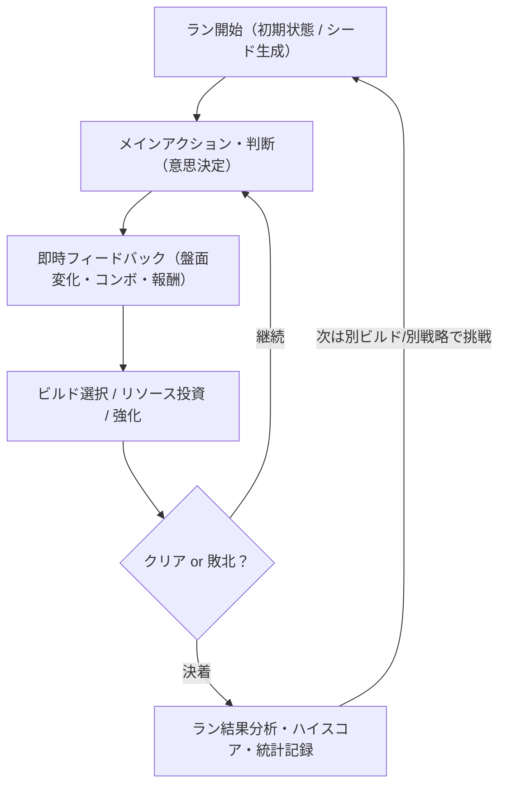

# 📋 ゲーム企画書：`<ゲームタイトル>` (`<game-id>`)

> [!IMPORTANT]
> **【最高責任者（人間）決裁ボックス】**
> - **現在のステータス**: `🟡 レビュー・Goサイン待ち (status:awaiting-approval)`
> - **企画提出日**: YYYY-MM-DD
> - **GitHub 企画Issue**: `#<issue_number>`
> - **決裁アクション**:
>   - [ ] **✅ Go（承認）** ── この企画で開発計画（Milestone/Issue作成）および段階的実装へ進む
>   - [ ] **🔄 条件付きGo / 修正指示** ── 下記フィードバックを反映して企画調整後に進行（または再提出）
>   - [ ] **❌ 却下** ── 別企画へ切り替え
> - **最高責任者からのフィードバック・指示メモ**:
>   - （人間が直接ここに書き込むか、チャット／GitHub Issueコメントで指示してください）

---

## 1. エグゼクティブサマリー（概要）

| 項目 | 内容 |
| :--- | :--- |
| **ゲームID** | `<game-id>` |
| **タイトル** | **<ゲームタイトル>** |
| **コンセプト（一言）** | <どんなゲームで、何が一番の中毒性・面白さなのかを1〜2文で> |
| **ジャンル / タグ** | <例：ローグライトパズル / 戦略ビルド構築 / スコアアタックアクション> |
| **想定1プレイ時間** | **<例：1プレイ 10〜20分（オートセーブ・中断再開対応） / または 1プレイ 2〜3分の高速周回>** |
| **プレイ時間の設定理由** | <なぜこのプレイ時間が本作のリトライ性と最も噛み合うのか> |
| **ターゲット体験** | <プレイヤーがプレイ中・終了後にどんな感情になり「もう1回」を押すか> |

---

## 2. 市場調査サマリー ＆ 差別化ポイント

### 2.1 市場背景・ベンチマーク
- **参考ベンチマーク作品**: <作品名A, 作品名B ...>
- **市場で支持されている理由**: <なぜそのジャンル・メカニクスが繰り返し遊ばれているのか>

### 2.2 本作独自のフック（差別化）
- **本作ならではの面白さ**: <既存作の単なる劣化コピーではなく、モバイル縦画面Webで輝く独自の掛け合わせ・システム>

---

## 3. リトライ性（Replayability）のコア設計

> **「なぜ1回で飽きず、10回・50回と繰り返し遊べるのか？」の設計証明**

### 3.1 コアループ図

### 3.2 リトライ性を生む4大要素

1. **毎プレイの変化（Procedural Variety）**:
   - <ランダム生成・出現順・マップ/イベント・初期条件など、毎回展開が変わる仕組み>
2. **プレイヤーの選択とビルド/戦略の幅（Strategic Synergies）**:
   - <少なくとも3系統以上の異なる勝ち筋・シナジー・プレイスタイルが成立する設計>
   - **系統A**: ...
   - **系統B**: ...
   - **系統C**: ...
3. **リスク＆リターンの駆け引き（Meaningful Decisions）**:
   - <安全策を取るか、リスクを冒して大きなリターン（高倍率・レア強化等）を狙うかの判断ポイント>
4. **上達の実感と敗北の納得感（Mastery & Fair Failure）**:
   - <運負けではなく「あそこであの選択をしていれば！」と振り返れる情報開示とリザルト統計>

---

## 4. ゲームシステム・画面・仕様詳細

### 4.1 画面レイアウト（モバイル縦画面 `375px〜430px` × `100dvh`）＆ 文字量予算（Text Budget）
- **上部エリア**: <ステータス・スコア・現在のウェーブ/ターン・中断セーブ状態（アイコン＋数字のみ）>
- **中央メインエリア**: <プレイヤーと敵/対象の対峙構図・Canvas/SVGアニメーション領域>
- **下部コントロールエリア**: <手札・スキル選択・操作パネル（片手親指で快適に操作可能）>
- **文字量削減ルール（`R-06` 遵守）**:
  - **タイトル画面の可視文字数上限**: 120文字以内（長文のあらすじや3行のクラス説明文は禁止。アイコン＋名前＋10文字以内のタグのみ）。
  - **段階的開示（Progressive Disclosure）**: 常時表示の解説文は置かず、タップ/ホールド時のみ1行ツールチップを表示する。

### 4.2 アクション・コレオグラフィ（手触り・アニメーション演出設計 / `R-07`・`R-08` 遵守）
> **※ 0ミリ秒で数値だけが書き換わる実装は禁止。[`docs/GAME_FEEL_AND_UX_PRINCIPLES.md`](../GAME_FEEL_AND_UX_PRINCIPLES.md)（桜井政博氏の7原則）に基づき、入力から結果までの時間軸演出を定義する。**
- **① 入力時の即時リアクション**: <選択時の拡大・バウンス・発光・SE>
- **② 予備動作（タメ）➔ 実行モーション**: <誰がどう動くか（踏み込み・弾道・スラッシュ軌跡・スロット順次発火など）>
- **③ ヒットストップ ＆ ダメージ演出**: <着弾時の瞬間停止（60〜90ms）、敵の白/赤フラッシュ、ノックバック振動、ダメージ数値ポップアップ跳躍>
- **④ 被弾・防御時の画面フィードバック**: <プレイヤー被弾時の画面全体赤フラッシュ＋シェイク、防御成功時のバリア火花＋`BLOCK!` 表示>

### 4.3 コアメカニクス・数値ルール
- **基本ルール**: ...
- **進行と難易度スケーリング（ステージ/ターン進行）**: ...
- **ゲームオーバー条件 / クリア（エンドレス突入）条件**: ...

### 4.3 セーブ・永続化仕様（`localStorage`）
- **ランの途中中断・再開（Auto-Save）**: <1プレイが数分を超える場合必須。リロードしても続きから遊べる仕組み>
- **ハイスコア・戦績・図鑑/アンロック記録**: <繰り返し遊ぶモチベーションを高める統計・達成記録>

### 4.4 アート・サウンド ＆ 素材・ライブラリ調達計画（無料原則）
- **ビジュアル（AI生成画像 / フリー素材 / Canvas・SVG）**:
  - **AI（Gemini等）で生成する静止画・イラスト**: <背景・敵キャラ・アイコン等>
  - **人間へ調達を依頼する無料フリー画像素材（ある場合）**: <具体的な内容・用途>
- **サウンド（無料フリー音声素材 ＋ 必要に応じブラウザ音響制御）**:
  - **人間へ調達を依頼する無料フリー効果音（SE）・BGMリスト**:
    - `se_xxx.mp3`: <どんな音か（例：サイコロを振る音、剣の斬撃音など）>
    - `bgm_xxx.mp3`: <どんな曲調か>
  - *(※素材未配置の開発初期でも動作するよう、コード側にはフォールバック仮音を用意する)*
- **追加導入する無料OSSライブラリ・ツール（ある場合）**:
  - <例：`canvas-confetti`（無料MITライセンス）等。すべて無料のものに限定>

---

## 5. ボットによる面白さ・リプレイ性検証計画（Replayability Metrics）

実装フェーズ（M1）にて、`logic.ts` の純粋関数シミュレーションを用いて以下の指標をボット検証します：

1. **スキル・戦略差**: 熟練戦略ボットがランダムボット・単調ボットを大きく上回ること。
2. **戦略の多様性（非単一解）**: 複数の異なるビルド方針ボット（例：攻撃特化／防御持久／コンボ特化）がいずれも一定の勝率・スコアを出せ、特定の「思考停止1強ハメ技」が存在しないこと。
3. **上達の階段**: 判断精度（ノイズ量）に応じて到達度・スコアが段階的に伸びること。
4. **適度な歯ごたえとニアミス**: 1回目で簡単にカンストせず、惜しい敗北（ニアミス）や劇的な逆転が起きること。

---

## 6. 開発ボリューム見積もり ＆ スプリント分割計画（Google One Pro 枠対応）

> **ワンショットで無理に作らず、利用枠（5時間ごとのリセット枠／日次スケジュール）に合わせて段階的に開発します。**

- **想定トータル規模**: 全 ◯ スプリント（5時間枠 × ◯ 回程度）
- **GitHub Milestone**: `Game: <ゲームタイトル> (<game-id>)`

| マイルストーン段階 | 対象Issue（予定） | 作業内容（成果物） | 完了条件（Gate） | 想定枠数 |
| :--- | :--- | :--- | :--- | :--- |
| **M1: コアロジック＆ボット検証** | `[M1] コアロジック＆リプレイ性ボット実装` | `logic.ts` 実装、状態遷移、シード乱数、複数戦略ボットによるバランス＆リプレイ性テスト | `vitest` 全通過・単一解でないことを数値証明 | 1枠 |
| **M2: プロトタイプUI＆基本ループ** | `[M2] グレイボックスUI＆基本コアループ結合` | `index.tsx` 基本画面、操作入力、1プレイ通しで遊べる骨格実装 | ブラウザ上で最初から最後までプレイ可能 | 1枠 |
| **M3: コンテンツ＆セーブ機構** | `[M3] ビルド要素拡張・セーブ/ロード・戦績実装` | アイテム/スキル/ステージ等のバリエーション実装、`localStorage` 中断再開＆戦績保存 | 全シナジー動作・リロード復帰テスト通過 | 1〜2枠 |
| **M4: アート・サウンド・UIポリッシュ** | `[M4] ビジュアル演出・Web Audio合成音・UX改善` | Canvas/SVGリッチ化、エフェクト、Web Audio効果音、モバイル操作感の磨き込み | モバイル画面はみ出しゼロ・全操作サウンド確認 | 1枠 |
| **M5: 総合QA・バランス調整・PR提出** | `[M5] E2E自動テスト・プレイ検証・最終PR作成` | `tests/e2e/<game-id>.spec.ts` 作成、lint/test/build/e2e全通過、PR作成 | 全技術QAパス・PR提出完了 | 1枠 |
